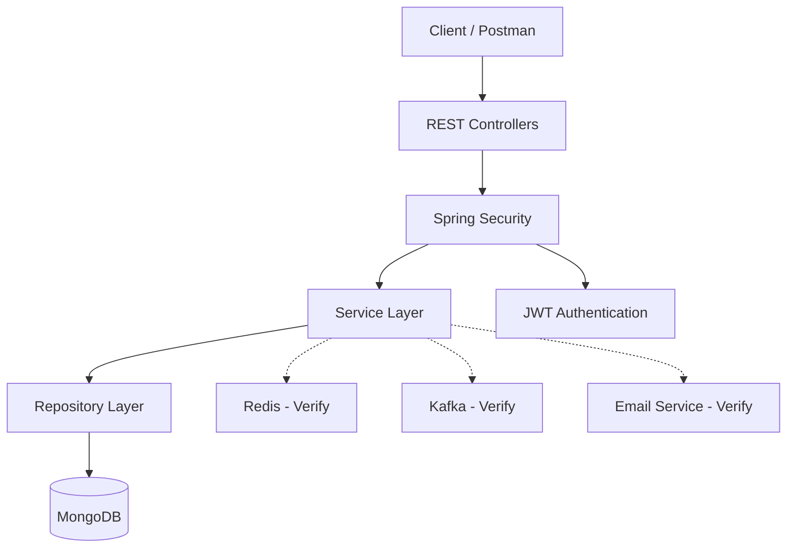

# Journal App – Secure Personal Journaling Backend

A Java-based journaling application built with Spring Boot, designed to provide secure journal management through REST APIs, authentication, authorization, and database persistence.

## Overview

Journal App is a backend application that allows users to manage personal journal entries through RESTful APIs. The project explores secure application development using Spring Security, JWT-based authentication, and MongoDB persistence.

## Tech Stack

| Category | Technology |
|---|---|
| Language | Java 17 |
| Backend | Spring Boot 2.7.16, Spring Web |
| Security | Spring Security, JWT |
| Database | MongoDB |
| Caching | Redis (integration status to verify) |
| Messaging | Apache Kafka (integration status to verify) |
| Email | Spring Mail (integration status to verify) |
| Testing | JUnit, Spring Boot Test |
| Build Tool | Maven |
| Code Quality | SonarQube |

## Architecture

The application follows a layered backend architecture.



## Features

### Implemented
- REST API-based backend.
- User authentication and authorization.
- Spring Security integration.
- MongoDB-based persistence.
- Journal entry management.
- JUnit testing for core functionality.

### In Progress
- Additional feature improvements and integration verification.
- Expanded test coverage and security validation.

### Planned
- Improved distributed request handling.
- Enhanced monitoring and application observability.
- Further security and performance improvements.

*Feature statuses should be updated after verifying the actual source code.*

## Project Structure

```text
Journal-App/
├── src/
│   ├── main/
│   │   ├── java/
│   │   └── resources/
│   └── test/
├── .mvn/
├── mvnw
├── mvnw.cmd
├── pom.xml
├── sonar-project.properties
└── README.md
```

## Getting Started

### Prerequisites
- Java 17
- Maven
- MongoDB instance
- Git

### Clone Repository

```bash
git clone https://github.com/jayendrasingh22/Journal-App.git
cd Journal-App
```

### Configuration

Configure database credentials and application secrets through environment variables or an external configuration file.

Never commit credentials or JWT secrets.

### Run Application

Windows:

```bash
mvnw.cmd spring-boot:run
```

Linux/macOS:

```bash
./mvnw spring-boot:run
```

## API Documentation

API endpoints and request/response examples will be documented after verifying the controller implementations.

## Testing

Run tests using:

```bash
mvnw.cmd test
```

## Code Quality

SonarQube Maven plugin is included for static code-quality analysis.

## Future Improvements

- Improve security and validation.
- Expand automated testing.
- Strengthen persistence and error handling.
- Improve application observability.

## Author

**Jayendra Singh**

Java Backend Developer

- GitHub: https://github.com/jayendrasingh22
- Repository: https://github.com/jayendrasingh22/Journal-App
